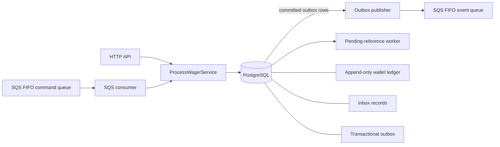

# Architecture

## Overview

The application is a modular monolith with independently runnable processes. HTTP and SQS command adapters call the same wager application service. PostgreSQL is the durable consistency authority. SQS provides asynchronous delivery, not financial correctness.

The deployable processes are the NestJS API, SQS consumer, pending-reference worker, and outbox publisher. They share the same source, database schema, and domain types. The domain package (`src/domain`) has no imports from NestJS, MikroORM, PostgreSQL, or AWS SDK modules.

## Components and boundaries

- **Domain (`src/domain`)**: exact `Money`, `Wallet`, `WagerTransaction`, ledger entries, Inbox/Outbox models, typed integration events, and stable failure codes.
- **HTTP adapters (`src/wallets`, `src/wagering`, `src/health`)**: input validation, status mapping, queries, readiness, and metrics route. They do not own database transactions.
- **Application service (`ProcessWagerService`)**: canonical request hash, wallet serialization, reference resolution, domain execution, persistent idempotency, and the financial transaction boundary. HTTP and SQS both call it.
- **Persistence (`src/persistence`)**: MikroORM setup and entities, reversible migrations, raw exact-decimal SQL, rehydration, PostgreSQL constraints, and the wallet opening adapter.
- **SQS consumer**: validates command envelopes, supplies Inbox identity, renews visibility, acknowledges after commit, and applies retry behavior to transient failures.
- **Pending-reference worker**: leases due work, locks the wallet before pending/reference wagers, and resumes the original domain transaction.
- **Outbox publisher**: claims events in a short SQL transaction, sends after that commit, and conditionally records success or retry only while its claim token remains valid.
- **Observability**: allow-listed structured logs, per-process Prometheus exposition, and bounded dependency health probes.

## Domain model

`Money` stores integer minor units as `bigint`. It is immutable, currency-aware, and serializes as a fixed-scale decimal string. The database stores amount and currency in separate columns as `NUMERIC(38,2)` and `CHAR(3)`. The persistence adapter reads amount as text and never converts it through JavaScript `number`.

`Wallet` is the aggregate root for one player's balance in one currency. Its version advances only when balance changes. `WagerTransaction` transitions from `PENDING` to one durable outcome (`PROCESSED`, `REJECTED`, `FAILED`) or to `PENDING_REFERENCE`, which can later resolve to a terminal outcome. Terminal states cannot transition again.

`WalletLedgerEntry` is immutable and records wallet, transaction, direction, amount, currency, before balance, after balance, and timestamp. A balance-changing transaction creates one ledger entry; `LOSS`, rejected operations, and missing-reference acceptance do not. `OPENING` is internal and is created only for positive initial balance.

`InboxMessage` records `(consumerName,messageId)`, the canonical full-envelope hash, and receipt/completion timestamps. `OutboxMessage` records a versioned event envelope, wallet aggregate, publication order, retry time/count, and temporary claim data. Integration event subclasses define stable event type and version and serialize `Money` as decimal-string properties.

## PostgreSQL schema invariants

Reversible migrations create and evolve `wallets`, `wager_transactions`, `wallet_ledger_entries`, `inbox_messages`, and `outbox_messages`. PostgreSQL enforces:

- one wallet per `(player_id,currency)`;
- non-negative wallet and ledger balances, positive ledger movement, and wallet version at least 1;
- valid `NUMERIC(38,2)` amounts and fixed three-letter currency columns;
- unique provider/idempotency key and provider/external transaction identity;
- wallet/player/currency and ledger/transaction/wallet/currency foreign-key consistency;
- at most one ledger row per wallet/transaction and exact direction arithmetic;
- one processed `REFUND` and one processed `ROLLBACK` for a reference transaction;
- Inbox primary key `(consumer_name,message_id)`;
- an append-only trigger rejecting ledger `UPDATE`, `DELETE`, and `TRUNCATE`.

Ordinary constraints cannot compare a wallet row against an aggregate over its ledger. The service commits wallet and ledger changes atomically, and the reconciliation endpoint compares the materialized balance with ledger reconstruction in a repeatable-read snapshot. Reconciliation reports a mismatch; it never repairs it automatically. A PostgreSQL superuser can disable triggers or alter schema; this database-level trust boundary is documented rather than presented as protection from a malicious administrator.

## Exact money

Inbound amounts are fixed-scale decimal strings. Parsing validates syntax and currency, then computes `whole * 100n + cents`. Domain arithmetic, balance comparisons, ledger before/after values, and snapshots remain exact. `Money` operations reject currency mismatch and do not mutate operands.

PostgreSQL `NUMERIC(38,2)` allows 36 integer digits plus 2 fractional digits. Request paths reject values that exceed that capacity before attempting persistence. API responses and event JSON retain decimal strings; monitoring values such as durations, counts, retry delays, and histogram buckets use ordinary numeric types because they are not monetary amounts.

## SQL transaction boundaries

### Wallet opening

`WalletOpeningService` depends on `WalletPersistencePort`; `WalletPostgresAdapter` owns MikroORM and raw SQL. One `EntityManager.transactional()` callback inserts the wallet and, for a positive opening amount, the internal processed `OPENING`, its credit ledger row, and outbox events. The `(player_id,currency)` unique constraint arbitrates concurrent attempts. A losing insertion rolls back all associated rows. A zero opening creates only the wallet with version 1.

### HTTP wager

`ProcessWagerService.process()` performs the following within one PostgreSQL transaction:

1. Lock the target wallet with `SELECT ... FOR UPDATE`.
2. Find an existing idempotency record and compare the persisted payload hash.
3. Insert a pending wager identity and resolve/lock its reference when supplied.
4. Apply the domain transition.
5. Update the wallet only if balance changed; insert its immutable ledger entry if returned.
6. Persist final wager state and original response snapshot.
7. Insert processed, rejected, pending-reference, and/or balance-changed outbox event rows.
8. Commit once.

No SQS network request occurs within this transaction. If any persistence step fails, wallet, wager, ledger, snapshots, and outbox roll back together.

### SQS wager

`processFromInbox()` inserts or locks the Inbox row and performs the same wager transaction as HTTP. The Inbox completion timestamp is committed with the outcome. The consumer calls `DeleteMessage` only after the service confirms commit. If the process crashes between commit and delete, SQS redelivers; the completed Inbox identity prevents a second financial effect.

### Pending reference

The worker initially claims rows in a short `FOR UPDATE SKIP LOCKED` transaction with `claimed_by` and `locked_until`, then performs recovery separately. During resolution the lock order is wallet → pending wager → referenced wager. The final state, optional wallet/ledger movement, response snapshot, and outbox events share one transaction. A lease or process crash leaves work claimable after expiration.

## Idempotency and conflicts

HTTP requires `Idempotency-Key`, scoped by provider. SHA-256 is computed over canonical JSON of normalized business fields with recursively sorted object keys. Headers and delivery metadata are excluded. Inbox uses a separate canonical hash of the complete validated SQS envelope, keyed by stable consumer identity and message ID.

Unique PostgreSQL constraints, not process memory, protect races across instances. A matching key/hash returns the stored original result snapshot, including its original balance and failure code. A matching key with a different hash returns `409` without financial side effects. The external transaction identity is independently unique per provider. The SQS FIFO deduplication window is not a substitute for these persistent rules.

## Concurrency and lock ordering

The wallet row is the unit of serialization. BETs, credits, reversals, and wallet-scoped wagers lock only the affected wallet. Requests for distinct wallets can progress independently. Reversals and their references must belong to the same wallet, so a wallet lock serializes financial operations that can consume the same balance. A partial unique index provides a persistent race guard for processed reversals.

The shared wager path takes the wallet lock before a referenced wager lock. Pending-reference recovery follows wallet → pending wager → referenced wager. Inbox identity is locked before wager processing in the SQS path; HTTP never takes Inbox locks and distinct Inbox keys do not participate in wallet/reference locking. Transient PostgreSQL deadlock (`40P01`) and serialization (`40001`) failures receive at most two retries after the first attempt, then map to a transient response/retry path.

The outbox publisher takes row claims with `FOR UPDATE SKIP LOCKED`, saves a per-claim token and lease, commits, and only then calls SQS. Its conditional update includes the token and unexpired lease. A slow stale publisher cannot overwrite a newer owner. A database-generated `publication_order` orders events written while their aggregate wallet lock is held. A candidate is eligible only when no earlier unpublished event exists for that wallet; backoff on one wallet does not block other aggregates.

## Inbox, outbox, and SQS semantics

The command queue and event queue are distinct FIFO queues. The consumer processes a command group sequentially and different groups concurrently. PostgreSQL row locks remain the consistency boundary. Business rejection and durable pending-reference acceptance are acknowledged after commit; transient errors receive bounded visibility backoff; invalid poison messages are left for the queue's redrive policy.

Outbox publication is at-least-once. There is no atomic commit spanning PostgreSQL and SQS. A crash before send leaves a lease for another publisher. A crash after SQS accepts a send but before `published_at` is committed can cause the same stable event ID to be sent again. Event consumers must durably deduplicate by event ID. The publisher never deletes or permanently abandons an event after a retry limit; it continues at the configured capped delay.

The outbox migration backfills old rows with a stable sequence based on occurred time and deterministic tie-breakers. Exact historical commit order for timestamp ties cannot be reconstructed for rows created before that sequence existed.

## Recovery, TTL, and retries

Pending references use a 60-second initial delay, exponential backoff capped at 30 minutes, a 24-hour TTL, and a maximum of 64 attempts. A missing/late REFUND or ROLLBACK is durably represented and emits one pending event. Reschedules do not emit duplicate pending events. Once the reference appears, the same domain rules determine success or rejection. Expiry, exhaustion, or a terminal invalid reference is persisted as a stable rejection and emits a rejection event.

The SQS consumer uses the native command-queue RedrivePolicy with `maxReceiveCount=5`; transient errors update message visibility with an exponential delay capped at 30 seconds. It renews visibility during processing and drains active work on SIGTERM. The outbox publisher uses persisted retry attempts and capped backoff. These retry systems are independent: command redelivery, pending-reference recovery, and outbox publication each have separate persistence semantics.

## Observability and security

Logs are newline-delimited JSON, with a timestamp, level, service, event name, and validated allow-listed identifiers. Bodies, money amounts, credentials, headers, and raw exception messages are excluded. HTTP correlation IDs are accepted only when they match a constrained identifier pattern; a UUID is generated otherwise. SQS reuses the message ID as correlation identity. Correlation travels into outbox event envelopes.

Metrics include bounded-cardinality counters, gauges, and histograms. Registries live only in process memory, reset on restart, and are not aggregated between replicas. API diagnostics bind to Compose loopback; worker diagnostic ports are internal-only. SQS depth attributes are approximate. The redrive metric is a consumer-side signal, not a broker-side transfer confirmation. Readiness performs bounded PostgreSQL and SQS probes; liveness is process-only. Compose worker health checks use liveness so temporary dependency outages do not mark a running process dead.

Authentication is not implemented. The challenge explicitly permits an external identity-provider integration point. No custom user/password scheme is claimed. A real deployment must add OIDC provider authentication/authorization, network restrictions, managed secrets, rate/request-size controls, and access control for operational endpoints before exposing the service publicly.

## Decisions and trade-offs

- **Pessimistic wallet locking**: simpler to reason about for a hot balance and reversal invariants than optimistic retry loops; unrelated wallets remain parallel.
- **PostgreSQL as authority**: unique constraints, row locks, transaction commits, and append-only triggers protect invariants across independent processes and crash recovery.
- **Exact integer minor units in the domain**: avoids floating-point rounding while preserving string JSON and exact NUMERIC persistence.
- **Inbox and outbox**: durable deduplication and event intent are written with the financial transaction; the cost is more database state and at-least-once downstream delivery.
- **Separate processes, one modular codebase**: allows independent scaling and recovery without creating separate network service boundaries for this challenge.
- **SQS FIFO**: preserves message ordering per group and reduces duplicate sends within the broker window, but does not provide exactly-once financial effects.
- **No custom auth, dashboards, central metrics service, Kubernetes, or double-entry ledger**: those are outside the required scope and would add operational surface without improving the required core guarantees.

## Known limitations

- No authentication provider, authorization policy, production deployment, managed database, or real AWS environment is configured.
- No downstream event consumer is included; event consumers must implement durable `eventId` deduplication.
- Metrics are process-local and require an external scraper/aggregation system for deployment-wide views.
- DLQ depth is approximate; redrive event metrics do not prove that SQS completed a transfer.
- PostgreSQL superusers can bypass triggers/constraints. The design protects application writes, not a malicious database administrator.
- Historical outbox event ordering before the publication sequence migration cannot be recovered exactly for events with tied timestamps.
- Authentication, rate limiting, API quotas, deployment network policy, and operational secret rotation are not implemented.
